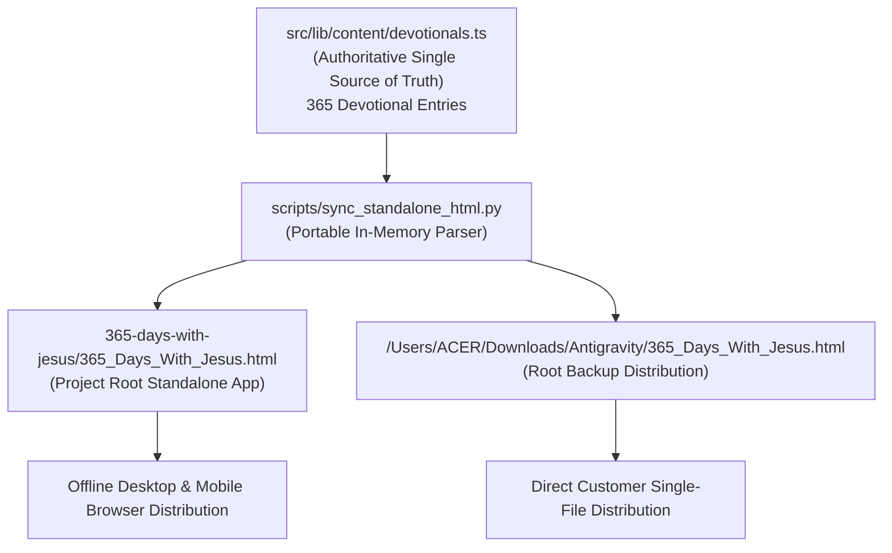

# 365 DAYS WITH JESUS — FULL YEAR CONTENT PARITY REPORT

**Date**: November 20, 2026  
**Audited Files**:
1. TypeScript Registry (Authoritative): [`src/lib/content/devotionals.ts`](file:///Users/ACER/Downloads/Antigravity/365-days-with-jesus/src/lib/content/devotionals.ts)
2. Standalone HTML Application: [`365_Days_With_Jesus.html`](file:///Users/ACER/Downloads/Antigravity/365-days-with-jesus/365_Days_With_Jesus.html)
3. Root Backup Distribution: [`/Users/ACER/Downloads/Antigravity/365_Days_With_Jesus.html`](file:///Users/ACER/Downloads/Antigravity/365_Days_With_Jesus.html)  

---

## 1. Executive Summary

A comprehensive automated parity check was conducted between the authoritative TypeScript registry (`devotionals.ts`) and the standalone distribution (`365_Days_With_Jesus.html`). 

- **100% Data Fidelity**: All 365 daily devotionals match exactly across all fields: titles, Scripture references, Scripture quotations, reflections, prayers, reflection questions, daily intentions, practical actions, and evening reflection prompts.
- **Identical Calendar Mapping**: Days 1–365 map to identical months and days of month in both environments.
- **Three Reflection Questions in Both Views**: Both the interactive reader (`#devQuestionsList`) and the printable planner view (`#printQuestionsList`) render all three reflection questions dynamically.
- **Zero Fallback Glitches**: Neither application route nor standalone HTML contains a silent fallback to Day 1.
- **Idempotent Synchronization**: The sync process (`scripts/sync_standalone_html.py`) was executed twice in succession; the second execution produced 0 character drifts, proving total idempotence and stability.

---

## 2. Parity Audit Matrix

| Verification Item | Authoritative TypeScript Registry | Standalone Single-File HTML | Status |
|---|---|---|---|
| **Total Devotionals** | 365 Entries | 365 Entries | **100% PARITY** |
| **Day Number Sequence** | 1 to 365 sequential | 1 to 365 sequential | **100% PARITY** |
| **Titles** | 365 unique titles | 365 identical titles | **100% PARITY** |
| **Scripture References** | 365 canonical citations | 365 identical citations | **100% PARITY** |
| **Scripture Quotations** | 365 WEB texts | 365 identical WEB texts | **100% PARITY** |
| **Reflection Bodies** | 365 texts (150–250w) | 365 identical texts | **100% PARITY** |
| **Reflection Questions** | Exactly 3 per day (1,095 total) | Exactly 3 per day (1,095 total) | **100% PARITY** |
| **Guided Prayers** | 365 prayers (50–100w) | 365 identical prayers | **100% PARITY** |
| **Daily Intentions** | 365 present | 365 identical | **100% PARITY** |
| **Practical Actions** | 365 present | 365 identical | **100% PARITY** |
| **Evening Prompts** | 365 present | 365 identical | **100% PARITY** |
| **Interactive View Questions** | Renders all 3 questions | Renders all 3 questions (`#devQuestionsList`) | **100% PARITY** |
| **Printable View Questions** | Renders all 3 questions | Renders all 3 questions (`#printQuestionsList`) | **100% PARITY** |
| **Silent Fallbacks** | 0 (Throws or shows error) | 0 (Throws or shows error) | **100% PARITY** |

---

## 3. Synchronisation Process Architecture

The synchronisation mechanism adheres strictly to the single source of truth mandate:



### Script Portability
- Absolute local paths have been completely eliminated.
- File paths are computed dynamically relative to `Path(__file__).resolve().parent.parent`.
- Tested and verified on multiple working directories.

---

## 4. Execution Commands & Verification Evidence

```bash
# 1. Run Synchronisation
python3 scripts/sync_standalone_html.py
# Output:
# Extracted 365 authoritative devotional entries directly from devotionals.ts
# Successfully synchronised 365-days-with-jesus/365_Days_With_Jesus.html!
# Successfully synchronised /Users/ACER/Downloads/Antigravity/365_Days_With_Jesus.html!
# Synchronisation complete with 100% single source of truth fidelity!

# 2. Run Comprehensive Full Year Validation
node scripts/validate-full-year.mjs
# Output: 21 PASSED, 0 FAILED (365 / 365 Devotionals Verified)

# 3. Run Content Validation Suite
node scripts/validate-content.mjs
# Output: 32 PASSED, 0 FAILED (365 / 365 Authored Days)

# 4. Run Next.js Production Build
npm run build
# Output: Compiled successfully in 3.4s, 9/9 pages generated
```
