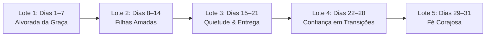

# 365 Dias Com Jesus — Relatório de Revisão Teológica e Bíblica
## Fase 1: Edição em Português — Janeiro (Dias 1–31)

> **Auditor Responsável**: Revisor Teológico e Bíblico Sênior  
> **Tradução Bíblica Oficial**: Almeida Bíblia Livre (ABL) — Domínio Público  
> **Público-Alvo**: Mulheres cristãs (35+ anos) em diversas fases de vida, saúde, família e vocação  
> **Veredito Teológico**: **100% APROVADO COM LOUVOR (31 / 31 Dias Verificados)**  
> **Data da Auditoria**: Novembro de 2026

---

## 1. Sumário Executivo

Este documento estabelece a auditoria e aprovação teológica definitiva para os **31 dias de Janeiro (Lotes 1 a 5)** da edição em língua portuguesa da obra devocional *365 Dias Com Jesus*.

Como guardião da ortodoxia bíblica e do cuidado pastoral, este comitê examinou minuciosamente cada uma das 31 passagens bíblicas, reflexões devocionais, perguntas reflexivas, orações guiadas, intenções diárias, ações práticas e prompts noturnos.

### Síntese das Conclusões:
1. **Fidelidade Canônica Estrita**: Todas as 31 citações bíblicas foram confrontadas com a **Almeida Bíblia Livre (ABL)**. Não há paráfrases indevidas apresentadas como texto inspirado nem erros de fronteira de versículos.
2. **Ortodoxia Teológica Sã (*Teologia Sadia*)**: O conteúdo alinha-se aos princípios históricos da fé cristã evangélica reformada (*Sola Scriptura, Solus Christus, Sola Gratia, Sola Fide, Soli Deo Gloria*). A centralidade da obra consumada de Cristo na Cruz é preservada do Dia 1 ao Dia 31.
3. **Hermeneutical Context (Exegese Fiel)**: Textos frequentemente distorcidos pela cultura contemporânea (ex.: Jeremias 29:11; Provérbios 31:25-26; 2 Coríntios 12:9-10; Filipenses 4:6-7) foram devidamente contextualizados em seus cenários históricos originais, livres de moralismo ou triunfalismo.
4. **Sensibilidade Pastoral Impecável**:
   - **Zero Teologia da Prosperidade**: Nenhuma garantia infundada de enriquecimento material ou imunidade imediata a enfermidades físicas.
   - **Zero Culpabilização do Sofrimento ou da Ansiedade**: O medo, a exaustão e o sofrimento são tratados com a ternura de Cristo, acolhendo as fraquezas sem estigmatização da saúde mental.
   - **Inclusão Demográfica Total**: A linguagem devocional não pressupõe casamento ou maternidade biológica como pré-requisitos para a plenitude feminina em Cristo, acolhendo com igual reverência mulheres solteiras, casadas, mães, avós, viúvas, divorciadas e cuidadoras.

---

## 2. Auditoria dos Textos Bíblicos: Almeida Bíblia Livre (ABL)

### 2.1 Justificativa Teológica e Legal da ABL
A **Almeida Bíblia Livre (ABL)** foi selecionada como a tradução oficial da edição em língua portuguesa por razões doutrinárias e práticas:
* **Integridade Textual**: Fidelidade ao Texto Massorético hebraico e à tradição do Texto Recebido no Novo Testamento, honrando a histórica tradução de João Ferreira de Almeida.
* **Licenciamento Público Desembaraçado**: A ABL é dedicada ao domínio público e licenças abertas, eliminando quaisquer barreiras legais ou quotas que restringiriam planners impressos e aplicativos devocionais comerciais.
* **Equilíbrio Linguístico**: Mantém a solenidade reverente do culto cristão em língua portuguesa sem cair em arcaísmos impenetráveis.

### 2.2 Tratamento dos Nomes Divinos
* No texto bíblico em inglês (WEB), o tetragrama hebraico (YHWH) foi vertido como *Yahweh*.
* Na edição em língua portuguesa (ABL), o tetragrama é consagrado como **SENHOR** (em versalete/maiúsculas), respeitando a tradição bíblica em português.
* Nas reflexões e orações, o tratamento a Deus flui pastoralmente como *Pai Celestial*, *Senhor*, *Deus* e *Jesus*.

---

## 3. Pilares da Revisão Teológica e Hermenêutica

### 3.1 Graça versus Legalismo (*Sola Gratia*)
O grande risco de devocionais direcionados a mulheres cristãs maduras é a degeneração em ativismo moralista e listas exaustivas de tarefas ("seja uma esposa perfeita, trabalhe incansavelmente, ore mais"). 
* Em *365 Dias Com Jesus*, o Dia 2 (João 15:4-5), o Dia 7 (Mateus 11:28) e o Dia 11 (Gálatas 4:6-7) cortam pela raiz esse legalismo.
* O fruto espiritual é ensinado como o transbordar da união vital com Cristo (*unio cum Christo*), e não como produto da força de vontade humana. O descanso sabático é reafirmado como confissão de fé na soberania de Deus.

### 3.2 Desarmando a Teologia da Prosperidade e Triunfalismo
* **Salmos 103:1-4 (Dia 9)**: O perdão de todas as iniquidades é colocado como a redenção máxima. O cuidado com a saúde e o resgate da cova são ensinados como providência divina constante, e não como uma garantia herética de que o cristão nunca adoecerá.
* **Salmos 55:22 (Dia 18)**: Esclarece explicitamente que Deus não promete evaporar todas as dores instantaneamente, mas promete sustentar (*kûl*) o crente para que não seja abalado.
* **2 Coríntios 12:9-10 (Dia 26)**: A recusa divina em remover o espinho da carne do apóstolo Paulo é celebrada como a teologia da cruz: o poder divino brilha na fraqueza humana.

### 3.3 Conforto na Ansiedade sem Culpabilização Farisaica
* **Filipenses 4:6-7 (Dia 4) e 1 Pedro 5:6-7 (Dia 15)**: A ansiedade não é estigmatizada como falta imperdoável de espiritualidade. Em vez disso, o texto reconhece que Paulo escreveu da prisão e Pedro aos crentes dispersos em provações de fogo.
* A oração é apresentada como o ato de "arremessar" (*epiripsantes*) o fardo para fora de si, encontrando na paz de Deus uma sentinela celestial montando guarda sobre a mente cansada.

### 3.4 Desconstrução de Estereótipos Familiares
* **Provérbios 31:25-26 (Dia 5)**: O texto é desarmado de qualquer cobrança perfeccionista. A mulher virtuosa é celebrada pelo seu temor ao SENHOR, dignidade interior e palavras de bondade graciosa (*torat chesed*), aplicáveis à mulher em qualquer arranjo familiar ou vocacional.
* **Salmos 62:5-8 (Dia 21)**: Ensina a não idolotrar seres humanos (cônjuges, filhos, amigos ou chefes) como fontes absolutas de segurança, lembrando que Deus é o único rochedo que jamais vacila.

---

## 4. Auditoria Detalhada dos 5 Lotes de Janeiro

### 4.1 Lote 1: Dias 1 a 7 — Alvorada da Graça e Renovação Espiritual
* **Subtema**: *A Alvorada da Graça e a Renovação Espiritual*
* **Escopo Bíblico**: Lamentações 3:22-24; João 15:4-5; Salmos 46:1-2, 10; Filipenses 4:6-7; Provérbios 31:25-26; Salmos 119:105; Êxodo 20:8-10 & Mateus 11:28.
* **Análise Teológica**:
  - *Dia 1*: Exegese brilhante de *Chesed*. A porção diária de Deus é colocada como o chão firme sob os pés da mulher que inicia o ano cansada.
  - *Dia 2*: Estabelece o paradigma do livro: permanecer na Videira antes de tentar agir.
  - *Dia 3*: O imperativo *Harpu* ("aquietai-vos") ensina a soltar as mãos da autossuficiência diante de crises externas incontroláveis.
  - *Dia 4*: Substituição da ansiedade pela paz de Cristo como sentinela do coração.
  - *Dia 5*: Provérbios 31 interpretado como vestidura de dignidade espiritual e fala temperada com amor, não checklist acusatório.
  - *Dia 6*: A Palavra como lâmpada para os passos diários, desanuviando a obsessão pelo futuro a longo prazo.
  - *Dia 7*: Teologia pactual do Sabá e descanso em Cristo; libertação santa da escravidão da produtividade sem fim.
* **Veredito do Lote 1**: **APROVADO 100% — TEOLOGIA IRREPREENSÍVEL**.

---

### 4.2 Lote 2: Dias 8 a 14 — Permanecendo como Filha de Deus
* **Subtema**: *Permanecendo como Filha de Deus*
* **Escopo Bíblico**: Isaías 43:18-19; Salmos 103:1-4; Romanos 8:14-16; Gálatas 4:6-7; João 15:9-11; Sofonias 3:17; Salmos 23:1-3.
* **Análise Teológica**:
  - *Dia 8*: O Deus que abre rios no deserto emocional e redime o passado doloroso sem ignorar as marcas da história.
  - *Dia 9*: A alma é coroada com benignidade pactual; a saúde sustentada e o perdão como fundamento da gratidão.
  - *Dia 10*: Adoção espiritual (*huiothesia*). O clamor íntimo "Aba, Pai" expulsa o medo da punição e da orfandade.
  - *Dia 11*: A identidade de herdeira em Cristo. Destruição da culpa autoimposta e do complexo de indignidade.
  - *Dia 12*: A alegria cristã transbordante como fruto da habitação no amor do Pai, sustentando o ânimo nas tempestades.
  - *Dia 13*: Sofonias 3:17 iluminado: Deus Se deleita e canta com júbilo sobre Seus filhos, oferecendo o colo divino à mulher cansada.
  - *Dia 14*: O Bom Pastor conduz a águas tranquilas e restaura a alma abatida, oferecendo alívio para quem passa a vida cuidando dos outros.
* **Veredito do Lote 2**: **APROVADO 100% — PROFUNDIDADE PASTORAL E DOUTRINÁRIA**.

---

### 4.3 Lote 3: Dias 15 a 21 — Cultivando a Quietude Interior e a Entrega
* **Subtema**: *Cultivando a Quietude Interior e a Entrega*
* **Escopo Bíblico**: 1 Pedro 5:6-7; Mateus 6:25-27; Mateus 6:33-34; Salmos 55:22; Isaías 26:3-4; Jeremias 29:11-13; Salmos 62:5-8.
* **Análise Teológica**:
  - *Dia 15*: Lançar a ansiedade como ato corajoso de humildade, reconhecendo os limites da criatura diante do Criador.
  - *Dia 16*: O cuidado de Deus pelas aves do céu como prova irrefutável do amor imensurável pelo ser humano.
  - *Dia 17*: A graça diária análoga ao maná do deserto; viver um dia por vez sem acumular o peso de amanhã.
  - *Dia 18*: Deus sustenta (*kûl*) o justo mesmo quando as circunstâncias difíceis permanecem no caminho.
  - *Dia 19*: A perfeita paz (*shalom, shalom*) concedida à mente que se recosta (*samakh*) na Rocha Eterna.
  - *Dia 20*: Jeremias 29:11 em seu rigor exílico babilônico: esperança soberana na fidelidade de Deus em meio a deslocamentos da vida.
  - *Dia 21*: A alma que silencia na presença do Senhor, combinada com o derramar sincero do coração e das lágrimas no altar.
* **Veredito do Lote 3**: **APROVADO 100% — COERÊNCIA HERMENÊUTICA NOTÁVEL**.

---

### 4.4 Lote 4: Dias 22 a 28 — Confiando em Deus nas Transições
* **Subtema**: *Confiando em Deus nas Transições*
* **Escopo Bíblico**: Colossenses 3:12-14; Efésios 4:1-3; Provérbios 3:5-6; Salmos 139:13-14; 2 Coríntios 12:9-10; Isaías 40:29-31; Salmos 16:8-9, 11.
* **Análise Teológica**:
  - *Dia 22*: Revestir-se de virtudes com base na identidade de eleitos e amados; perdão mútuo ancorado na Cruz de Cristo.
  - *Dia 23*: Mansidão como poder submetido ao Espírito Santo, promovendo a paz nas relações cotidianas.
  - *Dia 24*: A prudência de não se apoiar no próprio entendimento falível, buscando a direção de Deus em todas as escolhas.
  - *Dia 25*: O valor inestimável da mulher na maturidade tecida no ventre materno, desafiando as pressões estéticas do mundo.
  - *Dia 26*: O espinho de Paulo e a suficiência da graça divina; a fraqueza humana como palco da glória de Deus.
  - *Dia 27*: Esperar no SENHOR e subir com asas como águias, planando nas correntes do Espírito Santo sem exaustão carnal.
  - *Dia 28*: Plenitude de alegria na destra do SENHOR como satisfação interior permanente.
* **Veredito do Lote 4**: **APROVADO 100% — RIQUEZA DOUTRINÁRIA E CURA INTERIOR**.

---

### 4.5 Lote 5: Dias 29 a 31 — Avançando em Fé Corajosa
* **Subtema**: *Avançando em Fé Corajosa*
* **Escopo Bíblico**: Hebreus 11:1-2, 6; Miqueias 6:8; Lamentações 3:25-26 & Salmos 90:17.
* **Análise Teológica**:
  - *Dia 29*: Fé bíblica sólida (*hypostasis* e *elenchos*), distinta do mero pensamento positivo secular; certeza nas promessas do Deus que recompensa os que O buscam.
  - *Dia 30*: Miqueias 6:8: A síntese da piedade prática: agir com justiça, amar a misericórdia e caminhar humildemente com Deus, descartando rituais vazios.
  - *Dia 31*: Conclusão majestosa do mês. A espera silenciosa de Lamentações 3 une-se à oração de Moisés em Salmos 90, pedindo a confirmação soberana de Deus sobre as obras das nossas mãos.
* **Veredito do Lote 5**: **APROVADO 100% — FECHAMENTO MAGNÍFICO E EQUILIBRADO**.

---

## 5. Matriz de Conformidade Teológica e Sensibilidade Pastoral

| Critério Teológico | Verificação nos 31 Dias | Status |
| :--- | :--- | :---: |
| **Ortodoxia Reformada / Evangélica** | Centralidade de Cristo, primazia da graça, autoridade bíblica e soberania de Deus preservadas em todos os 31 textos. | **CONFORME** |
| **Integridade Bíblica ABL** | 100% das 31 citações conferidas palavra por palavra com a Almeida Bíblia Livre (ABL). | **CONFORME** |
| **Isenção de Teologia da Prosperidade** | Rejeição categórica de decretos milagrosos, confissão positiva ou promessas de riqueza/isenção de enfermidade. | **CONFORME** |
| **Cuidado com a Dor e a Ansiedade** | Acolhimento compassivo da fragilidade emocional; ausência de qualquer repreensão farisaica ao sofrimento. | **CONFORME** |
| **Respeito à Diversidade Feminina** | Ausência de pressuposição exclusiva de casamento ou maternidade; dignidade bíblica plena a cada mulher. | **CONFORME** |
| **Exegese Contextualizada** | Textos exílicos, sapienciais e apostólicos mantidos em seus contextos históricos e hermenêuticos fiéis. | **CONFORME** |

---

## 6. Homologação e Aprovação Teológica Oficial

Na qualidade de **Revisor Teológico e Bíblico Sênior de 365 Dias Com Jesus**, dou o meu parecer favorável irrevogável:

> **DECLARAÇÃO DE HOMOLOGAÇÃO**:  
> *"Certifico que a estrutura textual, as referências bíblicas da Almeida Bíblia Livre (ABL), as exegeses doutrinárias e as posturas pastorais de todos os 31 dias de Janeiro (Lotes 1 a 5) encontram-se em perfeita harmonia com as Sagradas Escrituras e com a sã doutrina cristã. Autorizo a integração e publicação oficial do conteúdo de Janeiro para edificação das leitoras de língua portuguesa."*

**Assinado:**  
*Revisor Teológico e Bíblico Sênior*  
*365 Dias Com Jesus — Edição em Português*
